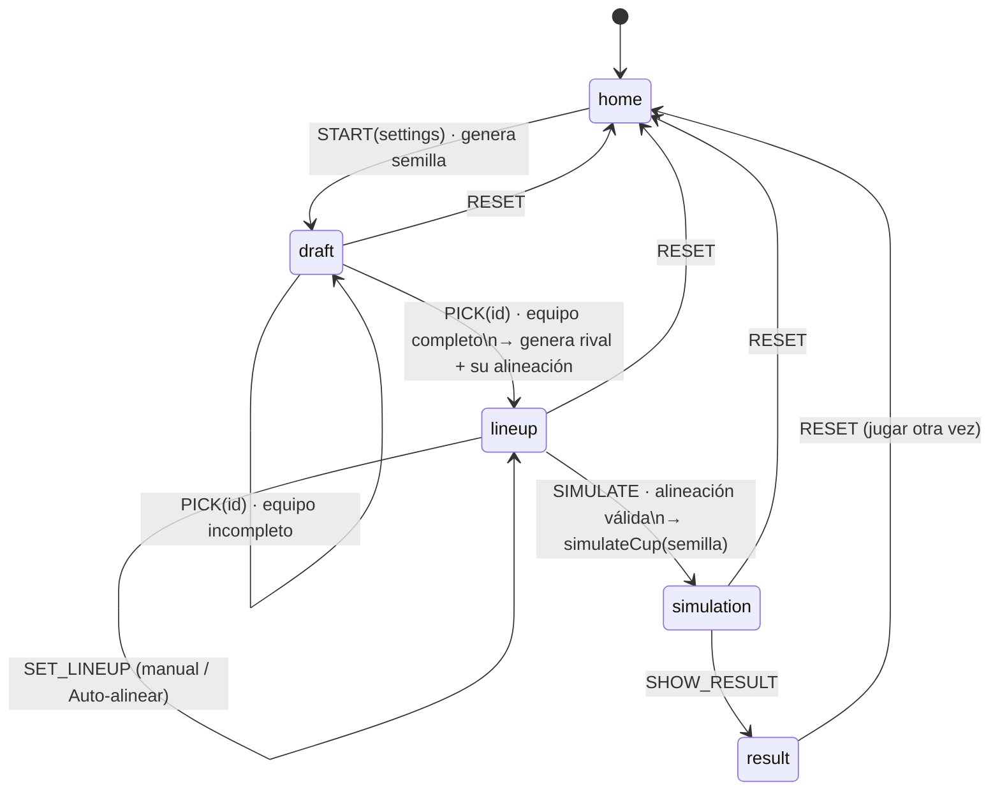

# Arquitectura

28-0 es una SPA estática (Fase 1): no hay servidor. El catálogo de jugadores es un JSON versionado, el motor de simulación es TypeScript puro y la tarjeta para compartir se rasteriza en el navegador.

```
┌──────────────────────────── Navegador ─────────────────────────────┐
│                                                                    │
│  React + MUI (screens/, components/)                               │
│        │ dispatch(action)          ▲ state                         │
│        ▼                           │                               │
│  state/GameContext.tsx  ── reducer puro (máquina de estados) ──┐   │
│        │                                                       │   │
│        ├─► engine/draft.ts      ruleta · filtro · rival        │   │
│        ├─► engine/lineup.ts     huecos · validación · auto     │   │
│        ├─► engine/simulator.ts  partido · copa · MVP · pareja  │   │
│        │       └─► engine/rating.ts  R, fourballs, foursomes   │   │
│        │       └─► engine/rng.ts     mulberry32 con semilla    │   │
│        ├─► config/gameConfig.ts pesos · k · modos · flags      │   │
│        └─► data/players.json    catálogo (65 fichas)           │   │
│                                                                    │
│  lib/share.ts  → html-to-image → PNG → Web Share API / descarga    │
└────────────────────────────────────────────────────────────────────┘
```

## Estructura de carpetas

```
src/
├── config/gameConfig.ts     # Todo lo ajustable: pesos, k, empate, bonus, dificultad, modos, flags
├── data/
│   ├── players.json         # Catálogo estático (fuente de verdad, editable sin código)
│   └── catalog.ts           # Carga tipada + índice por id
├── engine/                  # TypeScript puro, sin dependencias de React (testeable en Node)
│   ├── rng.ts               # RNG con semilla (mulberry32 + hash xmur3), streams derivados
│   ├── rating.ts            # Rating individual y por formato
│   ├── simulator.ts         # Probabilidad logística, simulateMatch, simulateCup, MVP, mejor pareja
│   ├── draft.ts             # Ruleta, filtrado, generación del rival
│   ├── lineup.ts            # Alineación vacía, asignación con intercambio, validación, auto-alinear
│   └── simulator.test.ts    # Tests (Vitest)
├── types/game.ts            # Tipos de dominio (Player, Lineup, CupResult…)
├── state/GameContext.tsx    # Reducer + Context: estado global de la partida
├── theme/theme.ts           # Tema MUI estilo Material 3 + colores de bando
├── lib/
│   ├── share.ts             # Exportación PNG y compartir
│   └── analytics.ts         # Fachada de eventos (game_started / finished / shared)
├── components/              # PlayerAvatar, PlayerCard, Roulette, ShareCard, AppHeader
├── screens/                 # Home, Draft, Lineup, Simulation, Result
├── App.tsx                  # Router por fase
└── main.tsx                 # Entrada + fuentes Inter
```

## Diagrama de estados de la partida



El reducer (`gameReducer`) es **puro y determinista**. Toda la aleatoriedad sale de RNGs derivados de la semilla de la partida:

| Paso | Stream | Uso |
|---|---|---|
| Tirada de ruleta del turno *n* | `seed:spin:n` | Combinación y segmentos decorativos |
| Rival | `seed:rival` | Selección del equipo rival |
| Simulación | `seed:sim` | Empates, ganadores y márgenes |

Usar *streams* independientes hace que la tirada *n* sea siempre la misma aunque cambien pasos anteriores; es la base del futuro **reto diario** (semilla = fecha).

## Flujo de datos por fase

1. **Home** → `START` con `{ side, modeId, variant, difficulty }`. Se crea la semilla y una alineación vacía.
2. **Draft** → la pantalla llama a `spinRoulette(PLAYERS, side, picks, deriveRng(seed, 'spin:n'))`. Solo pueden salir combinaciones con al menos un jugador disponible. Tras la animación, `filterBySpin` lista los candidatos (ordenados por rating). `PICK` añade el id; al completar el equipo el reducer llama a `generateRivalTeam` y `autoLineup` para el rival.
3. **Lineup** → `assignSlot` coloca o intercambia jugadores dentro de una sesión; `validateLineup` habilita «Simular»; `autoLineup` resuelve la alineación óptima.
4. **Simulation** → `SIMULATE` ejecuta `simulateCup` entero (milisegundos). La pantalla solo *revela* sesiones con un temporizador.
5. **Result** → lee `CupResult` (marcador, MVP, mejor pareja) y `ShareCard` se rasteriza con `nodeToPngBlob`.

## Decisiones técnicas

- **Vite + React + TS** en lugar de Next.js: la Fase 1 es 100 % estática y GitHub Pages solo sirve ficheros.
- **Motor sin React**: se puede ejecutar en Node (tests, calibración masiva, futuro servidor del reto diario) sin cambios.
- **Inyección de `resolve(id)`** en `simulateCup`: el motor no depende del catálogo concreto.
- **Feature flags** en `gameConfig.ts` (`GAME_MODES.full.enabled`, `GOLFIQ_ENABLED`): el modo completo y GolfIQ ya funcionan con el mismo código, solo están ocultos hasta la Fase 2.
- **`base` configurable** (`VITE_BASE`) para servir bajo `/<repo>/` en Pages o en la raíz en otro hosting.

## Evolución prevista

- **Fase 2**: API ligera + base de datos solo para reto diario, ranking y partidas guardadas (`partida { id, fecha, semilla, modo, bando, equipo[ids], alineación, resultado }`). El resultado se puede **verificar en servidor** re-ejecutando `simulateCup` con la misma semilla.
- **Fase 3**: empaquetado con Capacitor reutilizando la misma SPA.
